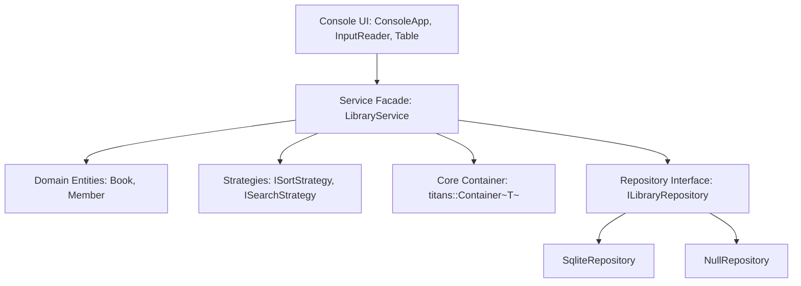
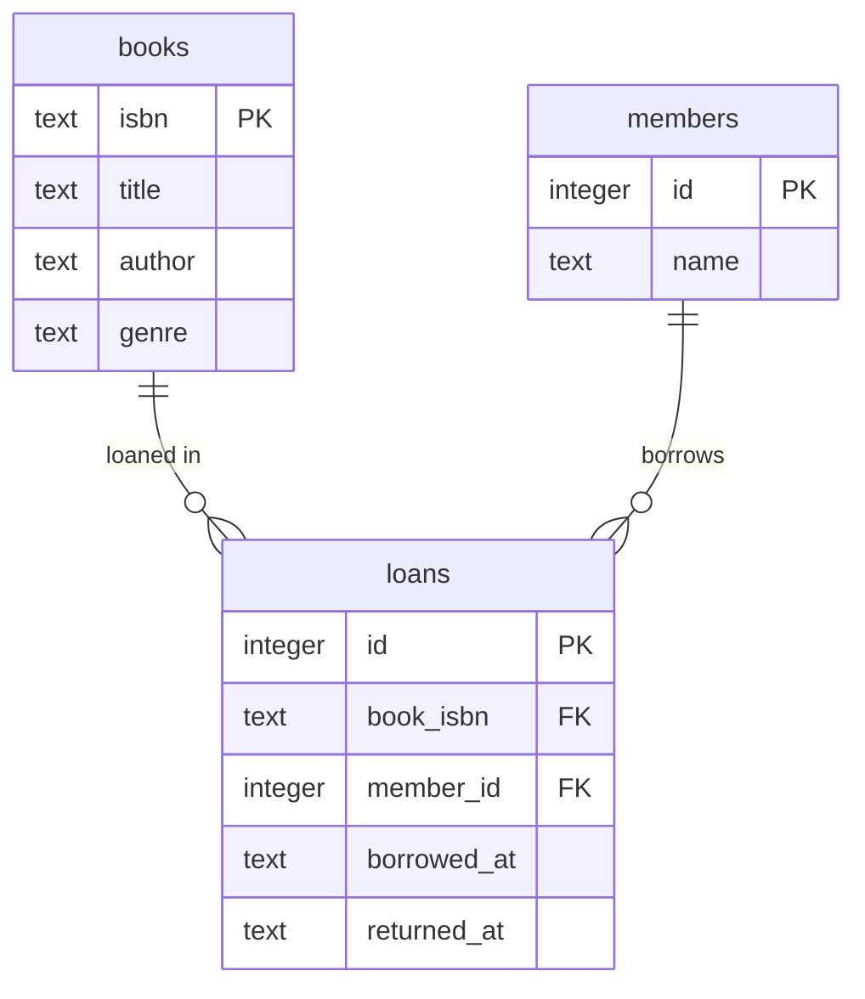

# Titans: Library Management System

[](https://gitdiagram.com/zoz646/library-management-system?utm_source=readme&utm_medium=badge)

Titans is an in-memory and SQLite-backed library management system written in modern C++17. At its foundation is a custom generic doubly linked list container (`titans::Container<T>`) supporting bidirectional iterators and in-place node-relinking merge sort and insertion sort without standard container dependencies. Built atop this container is a domain service layer providing book and member lifecycle tracking, borrowing rules, multi-attribute searching and sorting, and persistent ACID storage through SQLite. The entire codebase is verified with unit tests and randomized stress suites; AddressSanitizer and UndefinedBehaviorSanitizer are additionally enabled by default for GCC and Clang on Linux and macOS, and run in CI on the Ubuntu job.

## Requirements coverage

| Requirement | Implementation | Tests |
|---|---|---|
| Container: insert at the beginning | `core/Container.h`: `Container::push_front` | `tests/test_container.cpp`: `1. Default construction, empty state, push_front` |
| Container: insert at the end | `core/Container.h`: `Container::push_back` | `tests/test_container.cpp`: `2. push_back, size, order` |
| Container: insert at a specific position | `core/Container.h`: `Container::insert` | `tests/test_container.cpp`: `3. insert at head, middle, tail, out-of-range` |
| Container: remove by value | `core/Container.h`: `Container::remove_value` | `tests/test_container.cpp`: `5. remove_value existing, non-existing, duplicate` |
| Container: remove by position | `core/Container.h`: `Container::remove_at` | `tests/test_container.cpp`: `4. remove_at head, middle, tail, out-of-range` |
| Container: search by value | `core/Container.h`: `Container::find`, `Container::find_if` | `tests/test_algorithms.cpp`: `1. find: existing, non-existing, first occurrence` |
| Container: sorting algorithms | `core/Container.h`: `Container::sort`, `Container::insertion_sort` | `tests/test_algorithms.cpp`: `3. Merge sort: random, sorted, reversed`, `6. Insertion sort: random, sorted, reversed` |
| Container: iterator classes with begin / end / next / prev | `core/Container.h`: `Container::begin`, `end`, `next`, `prev` | `tests/test_iterator.cpp`: `1. Iterator navigation: begin, end, ++, --`, `7. next / prev step navigation` |
| Application: book catalog (title, author, ISBN, genre, availability) | `domain/Book.h`: `Book` class | `tests/test_book.cpp`: `1. Construction: valid inputs, invariant trimming` |
| Application: book insertion and removal | `service/LibraryService.h`: `LibraryService::add_book`, `remove_book` | `tests/test_library_service.cpp`: `add_book: valid book`, `remove_book: existing available book` |
| Application: book search by title / author / ISBN / genre | `service/SearchStrategy.h`: `TitleSearch`, `AuthorSearch`, `IsbnSearch`, `GenreSearch` | `tests/test_strategies.cpp`: `search strategies: TitleSearch, AuthorSearch, IsbnSearch, GenreSearch` |
| Application: book borrowing (and return) | `service/LibraryService.h`: `LibraryService::borrow_book`, `return_book` | `tests/test_library_service.cpp`: `borrow_book: valid borrow`, `return_book: valid return` |
| Application: book sorting by title / author / genre | `service/SortStrategy.h`: `TitleSort`, `AuthorSort`, `GenreSort` | `tests/test_strategies.cpp`: `sort strategies: TitleSort, AuthorSort, GenreSort` |
| Application: book statistics (total, available, borrowed) | `service/LibraryService.h`: `LibraryService::total_books`, `available_books`, `borrowed_books` | `tests/test_library_queries.cpp`: `statistics: total_books, available_books, borrowed_books` |

## Quick start

### Prerequisites
- A C++17 compliant compiler (GCC 9+, Clang 10+, or MSVC 2019+)
- CMake 3.16 or newer
- Git (only to clone this repository)
- SQLite 3.53.4 amalgamation is bundled under `third_party/sqlite/` and requires no external installation.
- doctest v2.4.11 is bundled as a single header under `third_party/doctest/` and requires no external installation.

No internet access is required to configure or build the project: both third-party dependencies are vendored under `third_party/`.

### Linux and macOS
```bash
cmake -S . -B build -DCMAKE_BUILD_TYPE=Release
cmake --build build
./build/titans_tests
./build/titans
```

### Windows (Developer PowerShell for Visual Studio)
```powershell
cmake -S . -B build -DCMAKE_BUILD_TYPE=Release
cmake --build build --config Release
.\build\titans_tests.exe
.\build\titans.exe
```

### Build options
- `TITANS_SANITIZE` (default `ON` for GCC and Clang on Linux and macOS, `OFF` elsewhere): builds with AddressSanitizer and UndefinedBehaviorSanitizer. Windows toolchains (both MSVC and MinGW/MSYS2) ship no sanitizer runtime, so the option defaults to `OFF` there, and passing `-DTITANS_SANITIZE=ON` anyway prints a CMake warning and is ignored. Use `-DTITANS_SANITIZE=OFF` to disable instrumentation on a supported platform.
- `TITANS_BUILD_BENCH` (default `OFF`): also builds the `titans_bench` benchmark executable from `bench/bench_container.cpp`. Use `-DTITANS_BUILD_BENCH=ON`.

### Command-Line Interface and Exit Codes
- `--db <file>`: Specifies the SQLite database path (default: `library.db`).
- `--db :memory:`: Runs in transient in-memory mode without touching disk.
- `-h`, `--help`: Displays the usage banner and exits with code 0.
- **Exit codes:** `0` on successful clean shutdown; `1` on unhandled runtime exception; `2` on invalid command-line flags.

## Using the application

The console interface provides an interactive menu for catalog management, loans, and statistics. At any input prompt, typing `/cancel` aborts the current operation and returns to the menu without mutating data. Sending end of input (Ctrl+D on Linux and macOS, Ctrl+Z then Enter on Windows) cleanly exits the program with exit code 0.

The application fully supports UTF-8 encoded text, including multi-byte Arabic script for titles and authors. Right-to-left visual shaping depends on terminal font capabilities.

### Sample Session Transcript
Produced by running: `printf "10\n8\n0\n" | ./build/titans --db :memory:`

```text
Database: :memory:
=== Titans Library Management System ===

Main menu
 1 List all books
 2 Add a book
 3 Remove a book
 4 Search books
 5 Borrow a book
 6 Return a book
 7 Sort the catalog
 8 Statistics
 9 Members
10 Load sample data
 0 Exit
Choose an option: Sample data loaded: 14 book(s) and 5 member(s) added.

Main menu
 1 List all books
 2 Add a book
 3 Remove a book
 4 Search books
 5 Borrow a book
 6 Return a book
 7 Sort the catalog
 8 Statistics
 9 Members
10 Load sample data
 0 Exit
Choose an option: --- Library statistics ---
Total books     : 14
Available books : 14
Borrowed books  : 0
Members         : 5

Main menu
 1 List all books
 2 Add a book
 3 Remove a book
 4 Search books
 5 Borrow a book
 6 Return a book
 7 Sort the catalog
 8 Statistics
 9 Members
10 Load sample data
 0 Exit
Choose an option: Goodbye!
```

## Architecture

The system follows a strict layered architecture with clean boundaries and dependency inversion:



The presentation layer (`ConsoleApp`) delegates all actions to the `LibraryService` facade, ensuring domain rules and invariants are encapsulated. The service orchestrates domain entities stored inside `titans::Container<T>` and synchronizes mutations to persistent storage via `ILibraryRepository`.

### Repository Tree
```text
.
├── CMakeLists.txt              # CMake build configuration with ASan/UBSan options
├── README.md                   # System documentation and user guide
├── main.cpp                    # Application entry point and CLI option parser
├── core/
│   └── Container.h             # Generic doubly linked list and bidirectional iterators
├── domain/
│   ├── Book.h / Book.cpp       # Book entity with ISBN validation and domain invariants
│   ├── Member.h / Member.cpp   # Member entity with borrowing constraints
│   └── Text.h                  # ASCII-folding and string trimming utilities
├── service/
│   ├── LibraryService.h / .cpp # Central domain service facade
│   ├── LibraryErrors.h         # NotFoundError and DuplicateError domain exceptions
│   ├── SortStrategy.h / .cpp   # Book sorting strategies and factory
│   └── SearchStrategy.h / .cpp # Book searching strategies and factory
├── repository/
│   ├── ILibraryRepository.h    # Abstract persistence interface
│   ├── NullRepository.h        # In-memory no-op repository implementation
│   └── SqliteRepository.h / .cpp # SQLite3 write-ahead persistence implementation
├── ui/
│   ├── ConsoleApp.h / .cpp     # Interactive console menu driver
│   ├── InputReader.h / .cpp    # Stream input parser with cancellation support
│   ├── Table.h / .cpp          # ASCII table formatter supporting UTF-8 widths
│   ├── Utf8.h                  # UTF-8 code point width calculation
│   └── DemoData.h / .cpp       # Sample books and members dataset loader
├── bench/
│   └── bench_container.cpp     # Empirical benchmark comparing Container with std::list
├── docs/                       # Architecture, design decisions, demo scripts, benchmarks
└── tests/                      # 18 unit and scenario test suites using doctest
```

## Design patterns

| Pattern | Problem It Solves | Where |
|---|---|---|
| Iterator | Encapsulates bidirectional list traversal while preserving encapsulation | `core/Container.h`: `BasicIterator`, `Iterator`, `ConstIterator` |
| Strategy | Decouples sorting and searching algorithms from service logic | `service/SortStrategy.h`, `service/SearchStrategy.h` |
| Factory | Centralizes instantiation of strategies from string tokens | `service/SortStrategy.h`: `SortStrategyFactory`, `SearchStrategyFactory` |
| Facade | Provides a single simplified API hiding domain and container complexity | `service/LibraryService.h`: `LibraryService` |
| Repository | Decouples domain logic from persistence mechanisms | `repository/ILibraryRepository.h`, `SqliteRepository.h` |
| Null Object | Eliminates null checks when persistence is not needed | `repository/NullRepository.h`: `NullRepository` |
| Command (Dispatch) | Maps menu selection numbers to callable actions cleanly | `ui/ConsoleApp.cpp`: `std::vector<MenuEntry>` dispatch table |

Key C++ techniques applied:
- **RAII:** Strict deterministic resource lifetime management for SQLite handles, prepared statements, and container nodes.
- **Rule of Five:** Explicit copy/move constructors and assignment operators in `titans::Container<T>`.
- **Templates:** Generic container implementation parameterizing arbitrary element types.
- **Const-Correctness:** Immutable read interfaces across domain models and iterators.
- **Move Semantics:** Efficient transfer of strings and container chains via `std::move`.
- **Exception Safety:** Enforced strong exception safety on all mutating operations.
- **Dependency Injection:** Streams injected into UI classes and repository pointers injected into the service.

## Data structures and complexity

A doubly linked list was selected to satisfy requirements for stable node references and $O(1)$ push/pop operations at both ends. Merge sort was chosen because it executes on linked lists via pointer relinking in $O(n \log n)$ time with zero memory allocations. Sorting is stable, ensuring that sorting by genre preserves prior alphabetical title ordering.

### Container Complexity
| Operation | Time Complexity | Extra Space |
|---|---|---|
| `push_front` / `push_back` | $O(1)$ | $O(1)$ |
| `insert` (by index) | $O(n)$ | $O(1)$ |
| `remove_at` (by index) | $O(n)$ | $O(1)$ |
| `remove_value` | $O(n)$ | $O(1)$ |
| `find` / `find_if` | $O(n)$ | $O(1)$ |
| `sort` (Merge Sort) | $O(n \log n)$ | $O(\log n)$ stack |
| `insertion_sort` | $O(n^2)$ worst, $O(n)$ best | $O(1)$ |

### LibraryService Complexity
Let $b$ be the number of books in the catalog, $m$ the number of registered members, $k$ the number of ISBNs a member currently holds (at most `Member::kMaxBorrowed`, that is 5), and $r$ the number of matches returned by a search.

| Operation | Time Complexity | Extra Space |
|---|---|---|
| `add_book` / `remove_book` | $O(b)$ | $O(1)$ |
| `has_book` / `get_book` | $O(b)$ | $O(1)$ |
| `add_member` / `remove_member` | $O(m)$ | $O(1)$ |
| `borrow_book` | $O(b + m + k)$ | $O(1)$ |
| `return_book` | $O(b + m \cdot k)$ | $O(1)$ |
| `search` | $O(b)$ | $O(r)$ matches |
| `sort_books` (Merge Sort) | $O(b \log b)$ | $O(\log b)$ stack |
| `total_books` | $O(1)$ | $O(1)$ |
| `available_books` / `borrowed_books` | $O(b)$ | $O(1)$ |

The cost of the database write is not included.

## Correctness and exception safety

`LibraryService` maintains four strict domain invariants across all operations:
- **I1:** ISBNs are unique across all books; member IDs are unique across all members.
- **I2:** A book is unavailable if and only if exactly one member holds its ISBN.
- **I3:** Every ISBN held in a member's borrowed list corresponds to an existing catalog book.
- **I4:** No member may hold more than 5 borrowed books simultaneously.

Mutations follow a write-ahead architecture: input validation occurs first, persistent database writes second, and memory modifications last. If disk I/O fails, memory remains unmodified (Strong Exception Guarantee). The only documented edge case is `std::bad_alloc` if node allocation fails after a write. When a sort comparator throws, the container guarantees basic safety: no nodes are leaked, and the bidirectional links are cleanly restored via `relink()`.

## Database



Database integrity rules:
1. Availability is derived dynamically from open loans (`returned_at IS NULL`) and is never stored as a separate column.
2. At most one open loan per book is enforced at the database level by a partial unique index (`CREATE UNIQUE INDEX idx_open_loans ON loans(book_isbn) WHERE returned_at IS NULL`).
3. All query arguments use parameterized binding (`sqlite3_bind_*`), precluding SQL injection.
State is restored at startup by replaying persisted books, members, and open loans through public service APIs. In-memory sort order is transient and not persisted.

## Testing

The test suite runs under doctest. AddressSanitizer and UndefinedBehaviorSanitizer are enabled by default for GCC and Clang on Linux and macOS (`TITANS_SANITIZE`), are not available on Windows toolchains (MSVC and MinGW/MSYS2, where the option defaults to `OFF`), and are therefore exercised in CI on the Ubuntu job only:
- **Test cases:** 189 passed (0 failed, 0 skipped)
- **Assertions:** 209,475 passed (0 failed)

These counts were measured on Ubuntu 24.04 with GCC 13.3.0 under AddressSanitizer and UndefinedBehaviorSanitizer (no sanitizer findings), and reproduced identically on Windows with MSVC 19.50 with sanitizers inactive.

| Test File | Focus Area |
|---|---|
| `test_container.cpp` | `Container` insertion, deletion, edge cases, stress test |
| `test_iterator.cpp` | Bidirectional iterators, bounds, cross-container checks |
| `test_algorithms.cpp` | Merge sort, insertion sort, find, stability, comparator exceptions |
| `test_book.cpp` | `Book` invariants, normalization, equality semantics |
| `test_member.cpp` | `Member` invariants, borrow limits, duplicate ISBN checks |
| `test_text.cpp` | UTF-8 preservation, ASCII case folding, trimming |
| `test_strategies.cpp` | Sorting and searching strategy implementations and factories |
| `test_library_service.cpp` | Service facade mutations, invariant maintenance, strong guarantee |
| `test_library_queries.cpp` | Catalog statistics, searches, member queries |
| `test_library_scenarios.cpp` | Multi-step user workflows and 3,000-operation randomized stress test |
| `test_ui_text.cpp` | UTF-8 table column formatting and width calculations |
| `test_input_reader.cpp` | Interactive input parsing, bounds checking, `/cancel` token |
| `test_console_app.cpp` | Menu navigation, actions, error formatting |
| `test_console_sessions.cpp` | Piped script sessions and randomized console fuzzing |
| `test_sqlite_repository.cpp` | Direct SQLite schema, prepared statements, constraint checks |
| `test_service_repository.cpp` | Service write-ahead integration with `SqliteRepository` |
| `test_persistence.cpp` | Database persistence round-trips and randomized loan replays |
| `test_main.cpp` | doctest entry point definition |

To run the automated suite:
```bash
ctest --test-dir build --output-on-failure
```

## Performance

Empirical benchmarking (`bench/bench_container.cpp`) measures `titans::Container<int>` against `std::list<int>` across sizes up to $n = 100\,000$. Both containers exhibit equivalent linear traversal and allocation timings, while `Container::sort()` scales with expected $O(n \log n)$ performance. Full results and methodology are documented in [docs/BENCHMARKS.md](docs/BENCHMARKS.md).

## Limitations and future work

- In-memory catalog sort order is transient and not saved to the database.
- Copies of a persistent `LibraryService` instance share the underlying repository handle.
- The service is designed for single-threaded execution and does not contain mutex synchronization.
- String case folding is restricted to ASCII characters; non-ASCII Unicode characters compare by raw byte value.
- Right-to-left bidirectional text shaping is not performed internally and relies on terminal capabilities.
- Borrowing does not track due dates, renewal counts, or overdue fines.
- ISBN validation checks length and digit/X format but does not verify ISBN-10/13 checksum digits.
- Cross-platform CI is configured for Linux, macOS, and Windows via GitHub Actions, but local testing was performed on Windows.
- The application is not designed for several instances using the same database file at the same time. Each instance loads the data once at start-up and does not refresh it. The database itself stays correct (a partial unique index allows only one open loan per book, so a second instance that tries to borrow an already borrowed book gets a database error), but the second instance can show outdated availability until it is restarted.

## Third-party software

- **SQLite**: Version 3.53.4 amalgamation bundled in `third_party/sqlite/` under Public Domain license ([third_party/README.md](third_party/README.md)).
- **doctest**: Version 2.4.11, bundled as a single header in `third_party/doctest/` under MIT License. `CMakeLists.txt` includes that header directly; nothing is downloaded at configure time.
