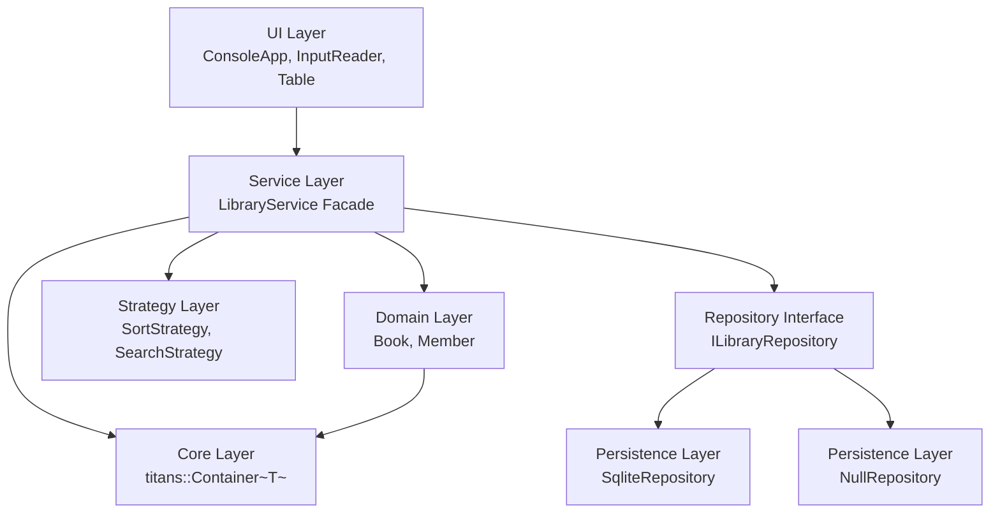
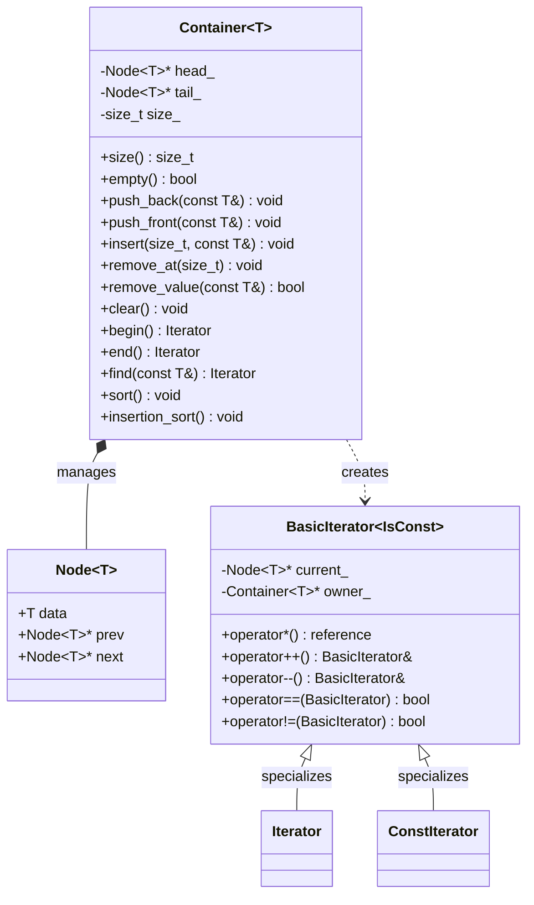
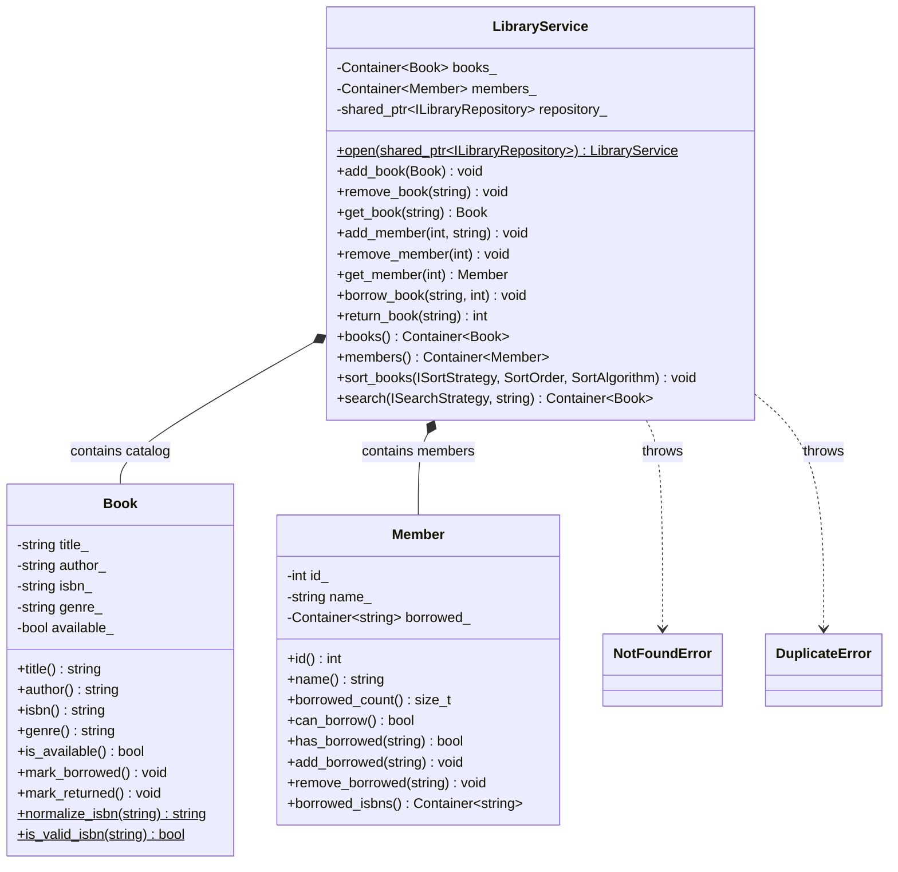
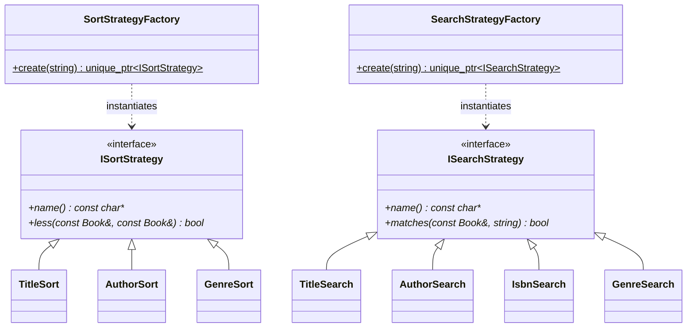
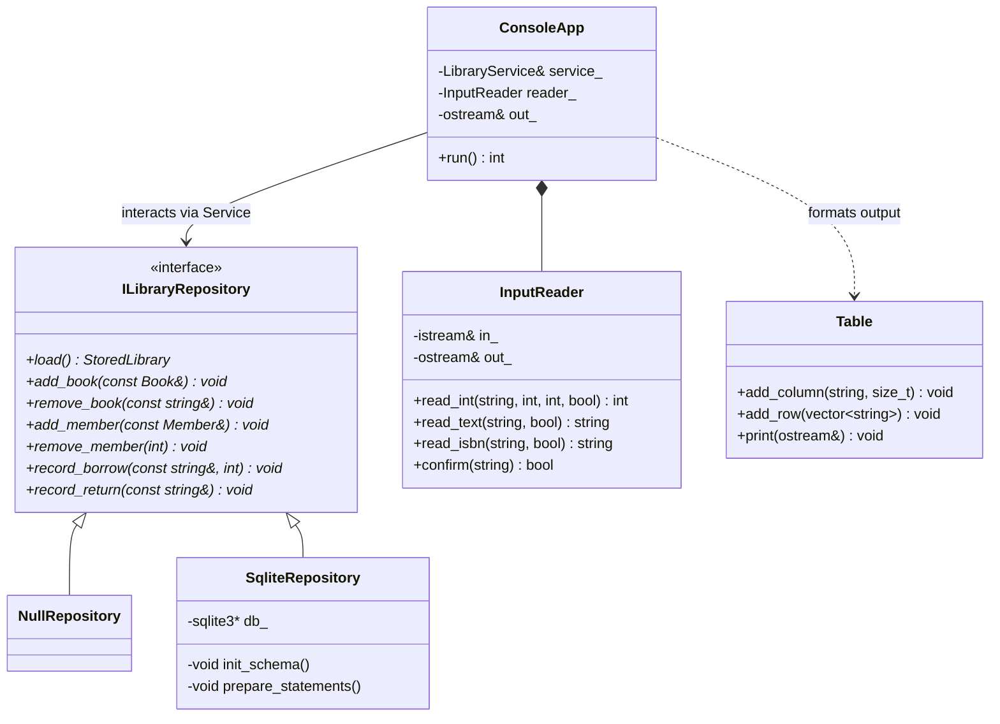
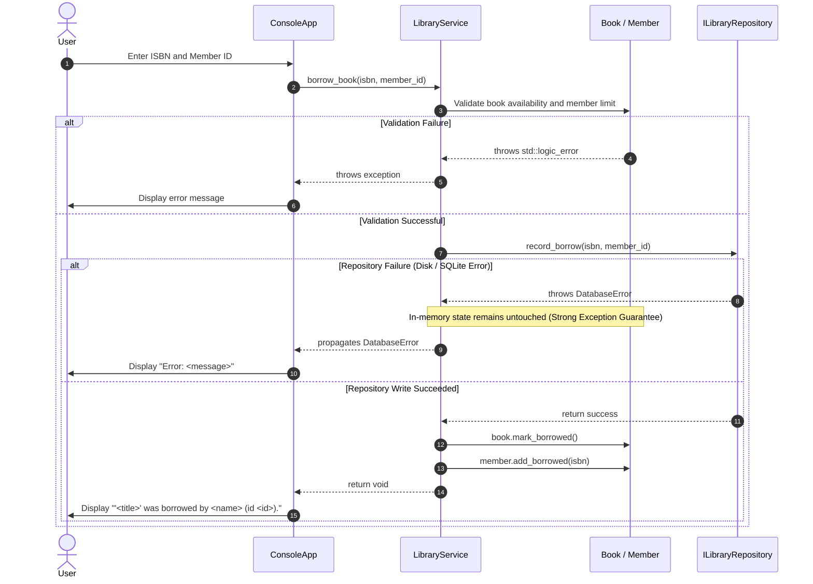
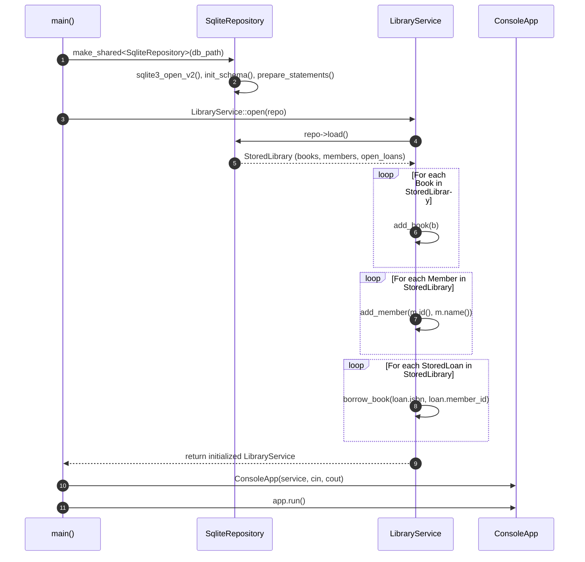

# Architecture and System Design

This document details the software architecture, component relationships, class structures, and runtime workflows of the Titans Library Management System.

## Architectural Layers

The following diagram shows the layered design and unidirectional dependencies between UI, service facade, domain models, custom container, and persistence abstractions.

---

## Core Container Architecture

The following diagram shows `titans::Container~T~`, its internal node structure, and its bidirectional iterator hierarchy.

---

## Domain and Service Layer

The following diagram illustrates the domain models (`Book`, `Member`), the central `LibraryService` facade, and custom domain exceptions.

---

## Strategy Hierarchy and Factories

The following diagram shows the extensible strategy hierarchies and corresponding factory objects for sorting and searching books.

---

## Repository and UI Architecture

The following diagram depicts the repository persistence abstraction and the console user interface subsystem.

---

## Sequence: Borrow Book Workflow

The following sequence diagram traces `borrow_book` through validation, persistent storage write-ahead, memory mutation, and exception handling.

---

## Sequence: Application Start-up and Replay

The following sequence diagram illustrates application startup, opening an existing SQLite database, and rebuilding domain state via the public API.

